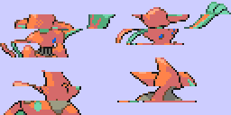
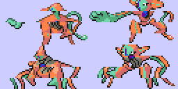
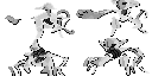
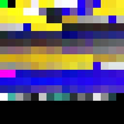
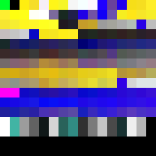
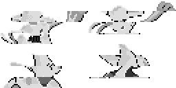

# FireRed public graphics

This page is generated from the repository's verified `graphics/` tree. Japanese and Korean assets are listed before English and other official languages.

## Header

| Preview | File | Language | Size | SHA-256 |
| --- | --- | --- | --- | --- |
|  | [`graphics/header/nintendo-logo-jp.png`](graphics/header/nintendo-logo-jp.png) | Japanese | 416x64 | `f07daf6e489d64b7...` |

## Pokemon

| Preview | File | Language | Size | SHA-256 |
| --- | --- | --- | --- | --- |
|  | [`graphics/pokemon/deoxys-attack-back-jp.png`](graphics/pokemon/deoxys-attack-back-jp.png) | Japanese | 256x128 | `c724a82a6f985eae...` |
|  | [`graphics/pokemon/deoxys-attack-front-jp.png`](graphics/pokemon/deoxys-attack-front-jp.png) | Japanese | 256x128 | `262ca8342218fa82...` |
|  | [`graphics/pokemon/pikachu-back-rev0-jp.png`](graphics/pokemon/pikachu-back-rev0-jp.png) | Japanese | 128x128 | `d1472dd2f4862fe9...` |
|  | [`graphics/pokemon/pikachu-back-rev1-jp.png`](graphics/pokemon/pikachu-back-rev1-jp.png) | Japanese | 128x128 | `d1472dd2f4862fe9...` |
|  | [`graphics/pokemon/pikachu-front-rev0-jp.png`](graphics/pokemon/pikachu-front-rev0-jp.png) | Japanese | 128x128 | `0be25ad9c369dfb5...` |
|  | [`graphics/pokemon/pikachu-front-rev1-jp.png`](graphics/pokemon/pikachu-front-rev1-jp.png) | Japanese | 128x128 | `0be25ad9c369dfb5...` |
|  | [`graphics/pokemon/deoxys-attack-back-en.png`](graphics/pokemon/deoxys-attack-back-en.png) | English | 256x128 | `c724a82a6f985eae...` |
|  | [`graphics/pokemon/deoxys-attack-front-en.png`](graphics/pokemon/deoxys-attack-front-en.png) | English | 256x128 | `262ca8342218fa82...` |
|  | [`graphics/pokemon/pikachu-back-rev0-en.png`](graphics/pokemon/pikachu-back-rev0-en.png) | English | 128x128 | `d1472dd2f4862fe9...` |
|  | [`graphics/pokemon/pikachu-back-rev1-en.png`](graphics/pokemon/pikachu-back-rev1-en.png) | English | 128x128 | `d1472dd2f4862fe9...` |
|  | [`graphics/pokemon/pikachu-front-rev0-en.png`](graphics/pokemon/pikachu-front-rev0-en.png) | English | 128x128 | `0be25ad9c369dfb5...` |
|  | [`graphics/pokemon/pikachu-front-rev1-en.png`](graphics/pokemon/pikachu-front-rev1-en.png) | English | 128x128 | `0be25ad9c369dfb5...` |
|  | [`graphics/pokemon/deoxys-attack-back-de.png`](graphics/pokemon/deoxys-attack-back-de.png) | German | 256x128 | `c724a82a6f985eae...` |
|  | [`graphics/pokemon/deoxys-attack-front-de.png`](graphics/pokemon/deoxys-attack-front-de.png) | German | 256x128 | `262ca8342218fa82...` |
|  | [`graphics/pokemon/pikachu-back-rev0-de.png`](graphics/pokemon/pikachu-back-rev0-de.png) | German | 128x128 | `d1472dd2f4862fe9...` |
|  | [`graphics/pokemon/pikachu-front-rev0-de.png`](graphics/pokemon/pikachu-front-rev0-de.png) | German | 128x128 | `0be25ad9c369dfb5...` |
|  | [`graphics/pokemon/deoxys-attack-back-fr.png`](graphics/pokemon/deoxys-attack-back-fr.png) | French | 256x128 | `c724a82a6f985eae...` |
|  | [`graphics/pokemon/deoxys-attack-front-fr.png`](graphics/pokemon/deoxys-attack-front-fr.png) | French | 256x128 | `262ca8342218fa82...` |
|  | [`graphics/pokemon/pikachu-back-rev0-fr.png`](graphics/pokemon/pikachu-back-rev0-fr.png) | French | 128x128 | `d1472dd2f4862fe9...` |
|  | [`graphics/pokemon/pikachu-front-rev0-fr.png`](graphics/pokemon/pikachu-front-rev0-fr.png) | French | 128x128 | `0be25ad9c369dfb5...` |
|  | [`graphics/pokemon/deoxys-attack-back-it.png`](graphics/pokemon/deoxys-attack-back-it.png) | Italian | 256x128 | `c724a82a6f985eae...` |
|  | [`graphics/pokemon/deoxys-attack-front-it.png`](graphics/pokemon/deoxys-attack-front-it.png) | Italian | 256x128 | `262ca8342218fa82...` |
|  | [`graphics/pokemon/pikachu-back-rev0-it.png`](graphics/pokemon/pikachu-back-rev0-it.png) | Italian | 128x128 | `d1472dd2f4862fe9...` |
|  | [`graphics/pokemon/pikachu-front-rev0-it.png`](graphics/pokemon/pikachu-front-rev0-it.png) | Italian | 128x128 | `0be25ad9c369dfb5...` |
|  | [`graphics/pokemon/deoxys-attack-back-es.png`](graphics/pokemon/deoxys-attack-back-es.png) | Spanish | 256x128 | `c724a82a6f985eae...` |
|  | [`graphics/pokemon/deoxys-attack-front-es.png`](graphics/pokemon/deoxys-attack-front-es.png) | Spanish | 256x128 | `262ca8342218fa82...` |
|  | [`graphics/pokemon/pikachu-back-rev0-es.png`](graphics/pokemon/pikachu-back-rev0-es.png) | Spanish | 128x128 | `d1472dd2f4862fe9...` |
|  | [`graphics/pokemon/pikachu-front-rev0-es.png`](graphics/pokemon/pikachu-front-rev0-es.png) | Spanish | 128x128 | `0be25ad9c369dfb5...` |
|  | [`graphics/pokemon/deoxys-normal-de-swatch.png`](graphics/pokemon/deoxys-normal-de-swatch.png) | Unspecified | 256x16 | `eb02b518552821e7...` |
|  | [`graphics/pokemon/deoxys-normal-en-swatch.png`](graphics/pokemon/deoxys-normal-en-swatch.png) | Unspecified | 256x16 | `eb02b518552821e7...` |
|  | [`graphics/pokemon/deoxys-normal-es-swatch.png`](graphics/pokemon/deoxys-normal-es-swatch.png) | Unspecified | 256x16 | `eb02b518552821e7...` |
|  | [`graphics/pokemon/deoxys-normal-fr-swatch.png`](graphics/pokemon/deoxys-normal-fr-swatch.png) | Unspecified | 256x16 | `eb02b518552821e7...` |
|  | [`graphics/pokemon/deoxys-normal-it-swatch.png`](graphics/pokemon/deoxys-normal-it-swatch.png) | Unspecified | 256x16 | `eb02b518552821e7...` |
|  | [`graphics/pokemon/deoxys-normal-jp-swatch.png`](graphics/pokemon/deoxys-normal-jp-swatch.png) | Unspecified | 256x16 | `eb02b518552821e7...` |

| Palette | Language | Colors | SHA-256 |
| --- | --- | --- | --- |
| [`graphics/pokemon/deoxys-normal-jp.pal`](graphics/pokemon/deoxys-normal-jp.pal) | Japanese | 16 | `479c76fdaf9a0ca4...` |
| [`graphics/pokemon/pikachu-rev0-jp.pal`](graphics/pokemon/pikachu-rev0-jp.pal) | Japanese | 16 | `066a8707fdfbf027...` |
| [`graphics/pokemon/pikachu-rev1-jp.pal`](graphics/pokemon/pikachu-rev1-jp.pal) | Japanese | 16 | `066a8707fdfbf027...` |
| [`graphics/pokemon/deoxys-normal-en.pal`](graphics/pokemon/deoxys-normal-en.pal) | English | 16 | `479c76fdaf9a0ca4...` |
| [`graphics/pokemon/pikachu-rev0-en.pal`](graphics/pokemon/pikachu-rev0-en.pal) | English | 16 | `066a8707fdfbf027...` |
| [`graphics/pokemon/pikachu-rev1-en.pal`](graphics/pokemon/pikachu-rev1-en.pal) | English | 16 | `066a8707fdfbf027...` |
| [`graphics/pokemon/deoxys-normal-de.pal`](graphics/pokemon/deoxys-normal-de.pal) | German | 16 | `479c76fdaf9a0ca4...` |
| [`graphics/pokemon/pikachu-rev0-de.pal`](graphics/pokemon/pikachu-rev0-de.pal) | German | 16 | `066a8707fdfbf027...` |
| [`graphics/pokemon/deoxys-normal-fr.pal`](graphics/pokemon/deoxys-normal-fr.pal) | French | 16 | `479c76fdaf9a0ca4...` |
| [`graphics/pokemon/pikachu-rev0-fr.pal`](graphics/pokemon/pikachu-rev0-fr.pal) | French | 16 | `066a8707fdfbf027...` |
| [`graphics/pokemon/deoxys-normal-it.pal`](graphics/pokemon/deoxys-normal-it.pal) | Italian | 16 | `479c76fdaf9a0ca4...` |
| [`graphics/pokemon/pikachu-rev0-it.pal`](graphics/pokemon/pikachu-rev0-it.pal) | Italian | 16 | `066a8707fdfbf027...` |
| [`graphics/pokemon/deoxys-normal-es.pal`](graphics/pokemon/deoxys-normal-es.pal) | Spanish | 16 | `479c76fdaf9a0ca4...` |
| [`graphics/pokemon/pikachu-rev0-es.pal`](graphics/pokemon/pikachu-rev0-es.pal) | Spanish | 16 | `066a8707fdfbf027...` |

## Title

| Preview | File | Language | Size | SHA-256 |
| --- | --- | --- | --- | --- |
|  | [`graphics/title/game-title-logo-en.png`](graphics/title/game-title-logo-en.png) | English | 256x64 | `9fc0ca8f171a833e...` |
|  | [`graphics/title/game-title-logo-de.png`](graphics/title/game-title-logo-de.png) | German | 256x64 | `391799cb35e5070d...` |
|  | [`graphics/title/game-title-logo-fr.png`](graphics/title/game-title-logo-fr.png) | French | 256x64 | `cef4662a5fc5e4f1...` |
|  | [`graphics/title/game-title-logo-it.png`](graphics/title/game-title-logo-it.png) | Italian | 256x64 | `80b9c45c106d0ae8...` |
|  | [`graphics/title/game-title-logo-es.png`](graphics/title/game-title-logo-es.png) | Spanish | 256x64 | `6f832d8857eae7e4...` |
|  | [`graphics/title/de-version-sprite-sheet-0.png`](graphics/title/de-version-sprite-sheet-0.png) | Unspecified | 256x128 | `77682dd651165b8d...` |
|  | [`graphics/title/de-version-sprite-sheet-1.png`](graphics/title/de-version-sprite-sheet-1.png) | Unspecified | 256x128 | `e8089662e8e03802...` |
|  | [`graphics/title/en-version-sprite-sheet-0.png`](graphics/title/en-version-sprite-sheet-0.png) | Unspecified | 256x128 | `77682dd651165b8d...` |
|  | [`graphics/title/en-version-sprite-sheet-1.png`](graphics/title/en-version-sprite-sheet-1.png) | Unspecified | 256x128 | `e8089662e8e03802...` |
|  | [`graphics/title/es-version-sprite-sheet-0.png`](graphics/title/es-version-sprite-sheet-0.png) | Unspecified | 256x128 | `77682dd651165b8d...` |
|  | [`graphics/title/es-version-sprite-sheet-1.png`](graphics/title/es-version-sprite-sheet-1.png) | Unspecified | 256x128 | `e8089662e8e03802...` |
|  | [`graphics/title/fr-version-sprite-sheet-0.png`](graphics/title/fr-version-sprite-sheet-0.png) | Unspecified | 256x128 | `77682dd651165b8d...` |
|  | [`graphics/title/fr-version-sprite-sheet-1.png`](graphics/title/fr-version-sprite-sheet-1.png) | Unspecified | 256x128 | `e8089662e8e03802...` |
|  | [`graphics/title/game-title-logo-de-swatch.png`](graphics/title/game-title-logo-de-swatch.png) | Unspecified | 256x256 | `34818291d91babda...` |
|  | [`graphics/title/game-title-logo-en-swatch.png`](graphics/title/game-title-logo-en-swatch.png) | Unspecified | 256x256 | `8e712b1be59ed294...` |
|  | [`graphics/title/game-title-logo-es-swatch.png`](graphics/title/game-title-logo-es-swatch.png) | Unspecified | 256x256 | `09eee41f9ac2abef...` |
|  | [`graphics/title/game-title-logo-fr-swatch.png`](graphics/title/game-title-logo-fr-swatch.png) | Unspecified | 256x256 | `d4ec601844e61f04...` |
|  | [`graphics/title/game-title-logo-it-swatch.png`](graphics/title/game-title-logo-it-swatch.png) | Unspecified | 256x256 | `712b19737becf98a...` |
|  | [`graphics/title/it-version-sprite-sheet-0.png`](graphics/title/it-version-sprite-sheet-0.png) | Unspecified | 256x128 | `77682dd651165b8d...` |
|  | [`graphics/title/it-version-sprite-sheet-1.png`](graphics/title/it-version-sprite-sheet-1.png) | Unspecified | 256x128 | `e8089662e8e03802...` |
|  | [`graphics/title/jp-version-sprite-sheet-0.png`](graphics/title/jp-version-sprite-sheet-0.png) | Unspecified | 256x128 | `77682dd651165b8d...` |
|  | [`graphics/title/jp-version-sprite-sheet-1.png`](graphics/title/jp-version-sprite-sheet-1.png) | Unspecified | 256x128 | `e8089662e8e03802...` |

| Palette | Language | Colors | SHA-256 |
| --- | --- | --- | --- |
| [`graphics/title/game-title-logo-en.pal`](graphics/title/game-title-logo-en.pal) | English | 256 | `e4c37140ce42fafe...` |
| [`graphics/title/game-title-logo-de.pal`](graphics/title/game-title-logo-de.pal) | German | 256 | `39177fb40e2a3821...` |
| [`graphics/title/game-title-logo-fr.pal`](graphics/title/game-title-logo-fr.pal) | French | 256 | `989be5f0154ffca3...` |
| [`graphics/title/game-title-logo-it.pal`](graphics/title/game-title-logo-it.pal) | Italian | 256 | `e0800c253d03d2aa...` |
| [`graphics/title/game-title-logo-es.pal`](graphics/title/game-title-logo-es.pal) | Spanish | 256 | `ec30aee185c2cc99...` |

Every entry is tied to at least one existing analysis or manifest record. Full hashes and provenance links are in `analysis/public-graphics-catalog.json`.
